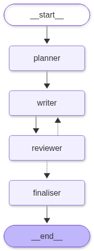

# langgraph-review-workflow

A multi-agent workflow built with **LangGraph** and **Google Gemini**. It turns a short topic into a
beginner-friendly technical explainer, like a short blog post.

The work is split across four specialised agents that hand work to each other. One of them is a
**reviewer that can send the work back**:

| Agent | Job | Uses the LLM? |
|---|---|---|
| **planner** | Turns the topic into an outline | yes |
| **writer** | Writes the draft, or revises it using the reviewer's feedback | yes |
| **reviewer** | Scores the draft against a written checklist, then approves it or sends it back | yes (structured output) |
| **finaliser** | Builds the final markdown and adds reviewer notes if a human must step in | no (plain code) |

## Quick start

```bash
python3.12 -m venv .venv && source .venv/bin/activate
pip install -r requirements.txt
cp .env.example .env          # then put your real GOOGLE_API_KEY in .env (it is git-ignored)

python -m workflow "Explain Kubernetes autoscaling for beginners"
pytest                         # runs with a fake LLM: no internet or key needed
```

Optional: set `GEMINI_MODEL=...` in `.env` to use a different model. The default is
`gemini-3.5-flash-lite`.

Each run prints every step live and saves:
- `output/final.md`: the finished explainer
- `output/trace.json`: every node that ran, every score, decision and draft revision

## The graph

Exported from LangGraph itself (`python scripts/export_diagram.py`). A PNG copy is in
[`docs/graph.png`](docs/graph.png). **Dotted arrows are conditional edges**: the reviewer decides
which way to go.




## The state schema

All agents share one state object, a `TypedDict` in [`workflow/state.py`](workflow/state.py).
Each node returns **only the fields it changed**, and LangGraph merges them in.

| Field | Type | Written by | Meaning |
|---|---|---|---|
| `topic` | `str` | user | The request, e.g. "Explain Kubernetes autoscaling for beginners" |
| `outline` | `str` | planner | Title plus 4–6 sections, one of them a concrete example |
| `draft` | `str` | writer | The current version of the article |
| `feedback` | `list[str]` | reviewer | Specific fixes for the latest draft |
| `scores` | `dict[str, int]` | reviewer | 1–5 per checklist item |
| `revision_count` | `int` | reviewer | How many times the reviewer has **rejected** a draft |
| `status` | `"planning" \| "writing" \| "revising" \| "approved" \| "needs_human_review"` | planner, reviewer | Where the workflow is, and how it ended |
| `history` | `list[dict]` (append-only) | every node | The trace. It uses a reducer (`operator.add`), so new entries are **appended**, not overwritten |
| `final` | `str` | finaliser | The finished markdown |

## How the reviewer decides

The reviewer gets a written checklist (in [`workflow/prompts.py`](workflow/prompts.py)) and must
reply in a fixed shape, the Pydantic `Review` model. It cannot just say "looks good":

```python
class ChecklistScores(BaseModel):
    accuracy: int    # 1-5: facts correct, nothing misleading
    clarity: int     # 1-5: a beginner can follow it, jargon explained
    structure: int   # 1-5: title, intro, logical sections, conclusion
    length: int      # 1-5: 5 if 300-600 words
    example: int     # 1-5: has a concrete, realistic example

class Review(BaseModel):
    scores: ChecklistScores
    passed: bool
    feedback: list[str]   # specific, actionable fixes
```

`llm.with_structured_output(Review)` makes Gemini answer in this shape, and LangChain parses it into
a Python object.

**The approve rule lives in code, not in the LLM.** The draft is approved only if **every score is
4 or higher**. The code recalculates this from the scores (`decide()` in
[`workflow/nodes.py`](workflow/nodes.py)) and ignores the model's own `passed` flag, because a
model can say "pass" while also giving a 3. Both values are saved in the trace, so you can see
when they disagree.

The conditional edge (`route_after_review` in [`workflow/graph.py`](workflow/graph.py)) then picks
the next node:

| Reviewer result | `status` | Next node |
|---|---|---|
| every score ≥ 4 | `approved` | finaliser |
| some score < 4, fewer than 2 rejections so far | `revising` | **writer**, with the feedback |
| some score < 4, this is the 2nd rejection | `needs_human_review` | finaliser |

## What happens when the reviewer rejects twice

`MAX_REVISIONS = 2` (in `workflow/state.py`). Without a limit, a strict reviewer and a stubborn
writer could loop forever and burn API calls. Step by step:

1. Writer writes draft 1. Reviewer **rejects** it, so `revision_count = 1` and it goes back to the writer with feedback.
2. Writer revises into draft 2, fixing the feedback. Reviewer **rejects again**, so `revision_count = 2`, which hits the limit.
3. The reviewer sets `status = "needs_human_review"` and the conditional edge routes to the **finaliser**, not the writer. **The loop stops.**
4. The finaliser still produces `final.md`, but puts a clear banner on top and adds the reviewer's last scores and notes at the bottom:

```markdown
> **STATUS: NEEDS HUMAN REVIEW**
> The reviewer rejected this draft 2 times (limit 2).

...the last draft...

## Reviewer's notes
Last scores: accuracy: 4, clarity: 3, ...
- <the reviewer's specific feedback>
```

So the writer runs **at most twice**, and the worst case is 5 LLM calls (planner, writer, reviewer,
writer, reviewer). A person gets the best draft plus a list of exactly what is still wrong, instead
of the workflow either looping forever or quietly publishing a draft that failed review.

Every LLM call also has a **60-second timeout and at most 2 retries**
([`workflow/llm.py`](workflow/llm.py)), so a busy model can't hang the workflow either.

## Tests

`pytest` runs the **real graph** with a **fake LLM** that returns scripted answers. No internet or
API key is needed.

| Test | Checks |
|---|---|
| `test_approve_first_time` | planner → writer → reviewer → finaliser, status `approved` |
| `test_revise_once_then_approve` | one loop back to the writer, and the writer's prompt contains the feedback |
| `test_reject_twice_needs_human_review` | stops after 2 rejections, writer ran exactly twice, notes in the output |
| `test_code_overrides_model_pass_flag` | model says `passed=True` with a 3, and the code still rejects |
| `test_state_schema_is_respected` | final state has exactly the schema's fields, with the right types |
| `test_scores_outside_1_to_5_are_rejected` | a score of 6 fails validation |
| `test_routing_function` | the conditional edge maps each status to the right node |
| `test_cli_run_writes_final_and_trace` | the CLI prints steps and writes both output files |

## Example runs

TODO: real runs not done yet (they need a `GOOGLE_API_KEY`). Only real output will go here.

## The failure mode I found

TODO: will be written after 5+ real runs on different topics.

## Project layout

```
workflow/
  state.py      state schema, Review model, MAX_REVISIONS
  llm.py        Gemini model with timeout + retry cap
  prompts.py    each agent's instructions, including the reviewer checklist
  nodes.py      planner, writer, reviewer, finaliser + the decide() rule
  graph.py      wires nodes together, including the conditional edge
  __main__.py   CLI: live step printing, saves final.md + trace.json
tests/          fake-LLM tests
scripts/        diagram export, API-key check (also installed as a pre-commit hook)
docs/           graph.png, graph.mmd
output/example/ one committed example run
```
